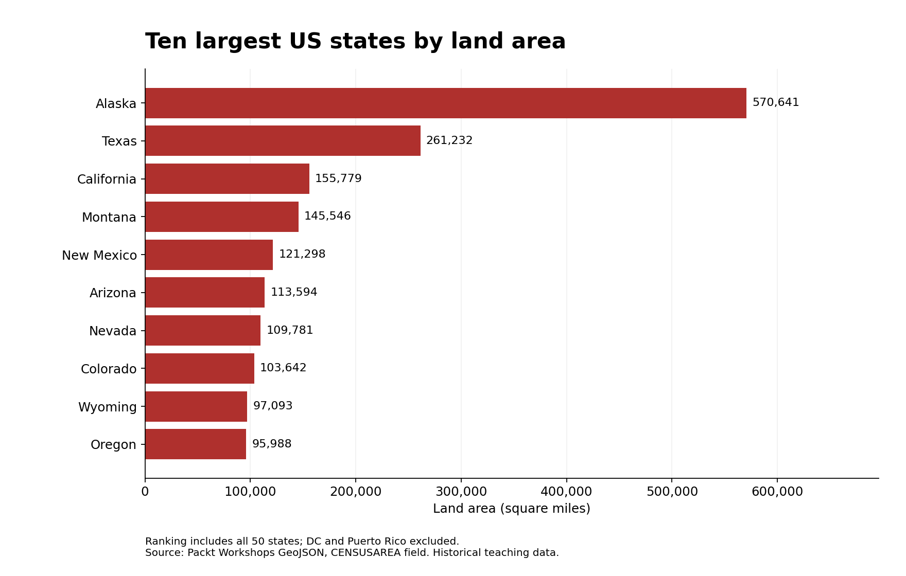

# US State Land Area Analysis

**Author: CHEN YU 陳鈺 · mc644339**  
**Status: completed analysis; portfolio peer review pending**

How does land area vary across US states, and what does a map hide when Alaska is outside the displayed extent? This project extends my CISC7204 Exercise 8.02 with a reproducible Python script and a ranked comparison. It measures land area, not population or a count of census districts.

## Dataset source and permissions

`us_states.json` is the public teaching dataset from [Packt Workshops, The Data Visualization Workshop](https://github.com/PacktWorkshops/The-Data-Visualization-Workshop/blob/a7c9f7adc4b0cb8ae81d3e04d35774e575bf9f39/Datasets/us_states.json), pinned to commit `a7c9f7adc4b0cb8ae81d3e04d35774e575bf9f39`. Its JSON content was verified against the dataset used in my coursework. The upstream repository provides it under the [MIT License](LICENSE-Packt.txt); that copyright and permission notice is retained here. The dataset has 52 geographic entries: 50 states, the District of Columbia, and Puerto Rico. Only the 50 states enter the ranking. `CENSUSAREA` gives land area in square miles.

This is a historical teaching dataset. It contains state boundaries and area attributes, with no individual-level personal data. No API credentials or restricted course files are included. No external map tiles are required.

## Methods and tools

Python's standard library reads GeoJSON, filters geographic entries, sorts the area values, and exports a CSV and findings JSON. NumPy and Matplotlib create a choropleth and a horizontal bar chart. The map uses ten red colour levels with a fixed range of 0–300,000 square miles, following the coursework. State borders come directly from the GeoJSON. No predictive model or causal inference is used.

## Visualizations and findings


Texas is the largest state shown in the contiguous-US map. Darker red means greater land area. Alaska and Hawaii are outside this view; the map does not claim to show every state.



The ranking includes all 50 states. Alaska is larger than Texas, so a mainland-only map can obscure the national maximum. Exact values and the Alaska-to-Texas ratio are generated in `findings.json`; the full ranking is in `state_area_summary.csv`.

## Limitation

This dataset is a historical snapshot, not a current boundary or population source. The map uses longitude and latitude with a fixed aspect adjustment, rather than an equal-area projection, so polygon sizes should not be measured from the image. Read area values from the chart or CSV instead. Colour quantization can also hide differences within the same colour bin.

## Reproduce the analysis

Use Python 3.12. From the repository root:

```bash
python3 -m venv .venv
source .venv/bin/activate
# Windows PowerShell: .venv\Scripts\Activate.ps1
python -m pip install -r requirements.txt
python analysis.py
```

This recreates `state_area_map.png`, `top_ten_states.png`, `state_area_summary.csv`, and `findings.json`. The data is bundled, so analysis requires no network connection after dependencies are installed. Paths are resolved relative to the script, not the terminal working directory. Assertions check the 52 source entries, 50 ranked states, and positive finite areas.

## Organization

- `analysis.py`: complete analysis and figure generation.
- `requirements.txt`: pinned direct dependencies.
- `us_states.json` and `LICENSE-Packt.txt`: source GeoJSON and upstream permission notice.
- `state_area_map.png` and `top_ten_states.png`: generated visualizations.
- `state_area_summary.csv` and `findings.json`: numerical results and data checksum.

## Attribution and AI assistance

Adapted from the topic and data used in CISC7204 Exercise 8.02 and the Packt teaching materials. AI assistance through OpenAI Codex was used to organize this portfolio extension, prepare the script and documentation, and check the outputs. This repository does not claim that a classmate has reviewed it. A future improvement will be recorded after genuine peer feedback is received.
